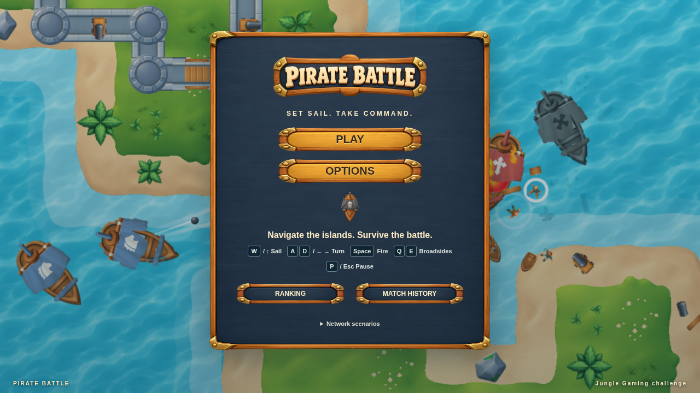

# Pirate Battle

A playable naval survival game built for the Jungle Gaming challenge. Sail between islands, fire three independent weapons, and survive Chasers and Shooters. React owns the interface; a deterministic TypeScript simulation drives PixiJS v8.

**Play it:** <https://pirate-battle-jungle-gamma.vercel.app>



## Run locally

Requires Node.js 22+ and npm 10+. No API account or private service is required.

```sh
npm ci
cp .env.example .env
npm run dev
```

Open the printed localhost URL. MSW starts in both development and production. Run through HTTP/HTTPS, not by opening `index.html` as a file. The browser must support WebGL and service workers for the full demo. If worker startup fails, gameplay and options remain available and the record panels show a recoverable error.

## Scripts

| Script                    | Purpose                                                                                |
| ------------------------- | -------------------------------------------------------------------------------------- |
| `npm run dev`             | Vite development server with React Strict Mode.                                        |
| `npm run build`           | Type-check, bundle and copy `assets/` into `dist/`.                                    |
| `npm run preview`         | Serve the optimized build.                                                             |
| `npm run typecheck`       | Strict TypeScript check without emitting.                                              |
| `npm run lint`            | ESLint plus a Prettier check.                                                          |
| `npm run format`          | Apply Prettier.                                                                        |
| `npm test`                | Vitest unit tests for the simulation, clock, projectiles and API ordering.             |
| `npm run test:e2e`        | Playwright desktop and mobile projects against the preview build on port 4173.         |
| `npm run test:e2e:update` | Rewrite visual baselines. Review the diff first; never use it to silence a failure.    |
| `npm run perf`            | Three-minute benchmark on Chromium's software rasterizer, plus five lifecycle cycles.  |
| `npm run perf:gpu`        | The same benchmark on the host GPU through ANGLE/Vulkan. Fails if no GPU is available. |
| `npm run memory`          | Thirty start/play/exit cycles with forced GC and resource counts.                      |

Run everything the way a clean checkout would:

```sh
npm ci
npm run typecheck
npm run lint
npm test
npm run build
npx playwright install chromium
npm run test:e2e
npx playwright show-report reports/playwright
npm run perf
npm run perf:gpu
npm run memory
```

Build before the E2E, benchmark and memory scripts; they serve `dist/`. The benchmark and memory scripts start their own preview servers on ports 4174 and 4175. Linux Chromium baselines are committed for both Playwright projects.

The only environment variable is `VITE_API_TIMEOUT_MS` (default `2500`). Vite reads it at build/start time. There are no secrets in the client configuration.

## Controls

| Action              | Keyboard                               | Touch               |
| ------------------- | -------------------------------------- | ------------------- |
| Sail forward        | W / ↑                                  | Up arrow            |
| Turn                | A / D or ← / →                         | Curved arrows       |
| Front cannon        | Space                                  | Front cannon button |
| Port broadside      | Q                                      | Left cannon button  |
| Starboard broadside | E                                      | Right cannon button |
| Sprint              | Shift                                  | » button            |
| Pause               | P / Escape                             | Pause               |
| Resume              | Resume button / Escape in pause dialog | Resume              |

Touch supports holding movement and weapons simultaneously. Mobile gameplay uses landscape; portrait displays a rotation notice and pauses the match. The logical arena never changes size. The canvas preserves its aspect ratio with letterboxing and caps pixel density at 2. Sound starts only after a player gesture and can be muted; the mute preference persists.

A Chaser impact costs 25 HP and awards no score. Destroying an enemy with your weapons awards one point. Leaving or refreshing an unfinished match abandons it. A completed result survives refresh. Each match takes a snapshot of options when it starts.

## Gameplay configuration

All balancing values are centralized in [`gameConfig.ts`](src/game/config/gameConfig.ts).

| Parameter               | Default                                                                   |
| ----------------------- | ------------------------------------------------------------------------- |
| World / solid tile size | 1600 × 900 / 64 px                                                        |
| Simulation              | 60 fixed ticks/second; maximum 8 catch-up steps/frame                     |
| Session length          | 120 s; Options accepts 60–180 s                                           |
| Enemy interval          | 4 s; Options accepts 1.5–15 s                                             |
| Enemy distribution      | 55% Chaser / 45% Shooter; first two successful spawns guarantee both      |
| Player                  | 100 HP, 160 px/s, 2.2 rad/s, 25 px collision radius                       |
| Front shot              | 10 damage, 520 px/s, 1.1 s lifetime, 0.45 s cooldown                      |
| Each broadside          | 3 parallel shots, 8 damage each, 520 px/s, 1.1 s lifetime, 1.4 s cooldown |
| Chaser                  | 30 HP, 150 px/s, 1.8 rad/s, 25 impact damage                              |
| Shooter                 | 40 HP, 110 px/s, 1.5 rad/s, 360 px attack range, 280 px stopping range    |
| Shooter shot            | 8 damage, 340 px/s, 2 s lifetime, 1.6 s cooldown                          |
| Spawn separation        | At least 450 px from player, clear of land and other ships                |
| Difficulty              | Normal; Options also offers Easy and Hard                                 |

Difficulty changes only what enemies do to the player. Your own weapons, enemy HP and scoring are identical on every level.

| Difficulty | Damage taken | Chaser impact | Shooter shot | Enemy speed |
| ---------- | -----------: | ------------: | -----------: | ----------: |
| Easy       |        × 0.5 |            13 |            4 |      × 0.85 |
| Normal     |          × 1 |            25 |            8 |         × 1 |
| Hard       |        × 1.5 |            38 |           12 |      × 1.15 |

Normal is the balance requested by the challenge and is the default. Rankings never mix difficulties: each one is a separate battle configuration in the Ranking filter.

**Sprint** multiplies the ship's speed by 1.75 for 1.5 seconds and can be used again 5 seconds after it was activated. The HUD shows whether it is ready, active or recharging. It only affects forward speed, so you still have to hold the sail key.

**Ship** in Options picks one of four hull colours (Black Flag, White Sail, Green Blades, Gold Cross). It is cosmetic; red and blue stay reserved for the Chaser and the Shooter. All six ship families in the art pack are now in use.

Enemy spawn positions and types are drawn from a seeded generator. A normal match gets a fresh random seed, so enemies arrive from different places every battle. Add `?seed=N` to the URL to replay a specific battle; test mode (`?test=1`) defaults to seed 42.

The 1.5 second minimum keeps entity growth bounded while permitting a hard mode; 15 seconds allows a calmer game. Requested combat defaults were retained. Wrecks, hit fragments, fire, flashes, explosions and splashes are cosmetic and never collide.

## Ranking, history and network scenarios

The local captain is `Captain Jack` until you set a **Captain name** in Options (3–16 characters); the name is stamped on each new record, and earlier records keep the name they were saved with. The captain's UUID persists across refresh. Other captains are deterministic fixtures. Rankings compare only identical session/spawn settings. Order is score descending, duration ascending, timestamp ascending, then match ID ascending. History is newest first. Each page contains five rows.

Open **Network scenarios** on the main menu, or append `?scenario=NAME`. A URL parameter overrides the stored scenario. The panel selection persists. **Reset mock data** restores the selected scenario's fixtures and clears pending submissions. Select `many-pages` and reset to create extended ranking/history fixtures. Scenarios cannot change combat.

| Scenario                        | Reproduce / expected behavior                                                                                               |
| ------------------------------- | --------------------------------------------------------------------------------------------------------------------------- |
| `success`                       | Open Ranking; fixtures load. Complete a battle; result becomes Saved.                                                       |
| `empty`                         | Both tabs show the empty state.                                                                                             |
| `many-pages`                    | On a fresh profile, or after reset, paginate ranking and the local captain's fixture history.                               |
| `slow`                          | Each API request takes 1.2 s; loading and background update states remain visible.                                          |
| `variable-latency`              | Seeded delays vary from 100 to 1199 ms.                                                                                     |
| `out-of-order`                  | Page 1 takes 1.2 s; later pages take 100 ms. Switch pages rapidly; old responses cannot overwrite the selected page.        |
| `timeout`                       | API takes longer than the configured Axios timeout; queries expose Retry, registrations remain Pending.                     |
| `network-error`                 | Requests fail at the network boundary. Finish a battle, then reload with `?scenario=success` to recover its pending record. |
| `http-4xx`                      | HTTP 400; no automatic retry. Result shows Failed and offers Retry while keeping the record locally.                        |
| `http-5xx`                      | HTTP 503; two automatic retries with exponential backoff, then recoverable error/Pending.                                   |
| `ranking-fails`                 | Only ranking returns 503; history and gameplay still work.                                                                  |
| `history-fails`                 | Only history returns 503; ranking and gameplay still work.                                                                  |
| `register-timeout-after-commit` | The first PUT commits, then exceeds client timeout. Its retry returns the existing match with 200; no duplicate is created. |
| `offline-then-recover`          | First three registration attempts fail. Automatic retries exhaust; result Retry succeeds on attempt four.                   |

Query retries apply only to network errors and 5xx, never 4xx/cancellation. Starting another battle is allowed while records are pending. The queue is written before sending, replayed on app startup and removed only after acknowledgment. Data is local to the browser; this is an API integration demo, not a shared multiplayer service.

## Testing and profiling

The suite covers the challenge's twelve E2E groups, including actual keyboard movement/fire, island and boundary collision, both enemy types, cooldowns, unique scoring, time/death endings, pause/blur, refresh/abandonment, touch, pagination and durable/idempotent submission recovery. Pure simulation tests additionally exercise swept collision, double hits and deterministic replay. Each Playwright test gets a fresh browser context and empty storage.

`?test=1&seed=42` disables automatic time advancement. `window.__PIRATE_TEST__` exposes `advance(ms)`, `getState()` (a detached serializable snapshot), `setSeed(n)` before the first tick and read-only resource counts. Rules, input handlers, collisions and Pixi rendering remain active. `window.__PIRATE_RESOURCES__()` reports active applications, display objects and cached textures for profiling. These hooks never provide state mutation, teleportation or invulnerability.

The latest full run passed 58 browser cases with 4 skipped: the multitouch, touch-sprint and portrait cases apply only to the mobile project, and the keyboard-sprint case only to desktop. All 29 unit tests pass. The HTML report is committed under [`reports/playwright`](reports/playwright/index.html); failed runs retain traces in `test-results/`.

### Benchmarks

The performance harness uses real keyboard events and `requestAnimationFrame` intervals for 180 seconds of active sampling. Default matches last 120 seconds, so the harness restarts after real match endings and reports how many matches were needed.

| Reference machine: i5-3470, Radeon RX 580, Chromium 156, 1280 × 720 | Average FPS | p95 frame |
| ------------------------------------------------------------------- | ----------: | --------: |
| Hardware GPU (`npm run perf:gpu`)                                   |       60.01 |   16.7 ms |
| Software rasterizer, no GPU (`npm run perf`)                        |       26.83 |   50.1 ms |

The 60 FPS target is met with a GPU and not met on the software rasterizer. The game's own script work is 0.43 ms per frame in both. A peak of 28 simulation entities and 100 display objects was observed. [`reports/performance.md`](reports/performance.md) has the full method, the before/after comparison, the memory investigation and the raw data files. These numbers describe one machine and are not a claim about unmeasured devices.

Repeated matches release every Pixi application, canvas and scene object. One real leak was found and fixed: PixiJS 8.22 leaves one shader bind group subscribed to a global texture for each destroyed application. The 48 game textures stay cached between matches on purpose (36 when the benchmarks were recorded, before the extra ship colours were added).

## Deployment

`vercel.json` contains the Vite build settings, the SPA rewrite and the service-worker headers. `mockServiceWorker.js` is served with `max-age=0, must-revalidate`, never as an immutable asset, so a new deployment cannot be stuck behind a stale worker. Game art and the MSW worker are included in `dist/`. No backend or environment variables are needed.

```sh
npx vercel login
npx vercel --prod
```

Live at <https://pirate-battle-jungle-gamma.vercel.app>. The checks run against it are recorded in [`reports/verification.md`](reports/verification.md).

## Delivery notes

See [`ARCHITECTURE.md`](ARCHITECTURE.md) for lifecycle and API decisions, [`docs/PLAN.md`](docs/PLAN.md) for phase status, [`docs/CHALLENGE.md`](docs/CHALLENGE.md) for the original brief, and [`ASSETS_LICENSE.md`](ASSETS_LICENSE.md) for provenance. Work is organized into conventional commits per phase.

## Known limitations

- Ranking and history live in this browser's localStorage behind MSW. They are not shared between players or devices, and scores are not validated by a server.
- 60 FPS was measured on one desktop GPU. Without a GPU, Chromium's software rasterizer reaches about 27 FPS on the reference machine. No phone or tablet was profiled.
- Memory checks count JS-side resources in Chromium. Mobile GPU memory was not measured.
- Enemy steering is local obstacle avoidance, not pathfinding; enemies can take detours around island corners.
- Ships collide as circles smaller than their sprites, so bows and sterns can visually overlap shorelines.
- Portrait orientation on touch devices pauses the match and asks for landscape.
- Visual baselines are for Chromium on Linux; other platforms render fonts differently.
- Cut for time: ambient audio loops, richer debris particles, animated water.
